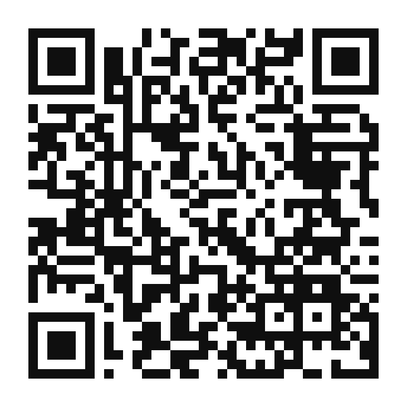
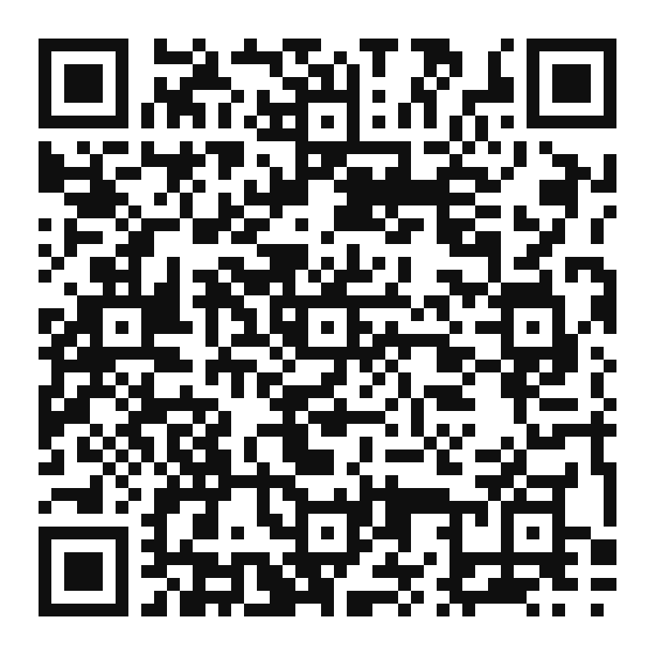

# 📘 Guia de Bolso: Cultura Digital com Direitos (ECA Digital & BNCC)

> **Projeto Prático + Seminário — Disciplina de Tópicos Especiais II**  
> **Curso:** Licenciatura em Computação — Instituto Federal de Mato Grosso do Sul (IFMS) — Câmpus Jardim  
> **Docente:** Prof. Giovanni Netto Calixto  
> **Data de Apresentação:** 03 de novembro de 2026

---

## 🎯 Sobre o Projeto

O projeto **Guia de Bolso: Cultura Digital com Direitos** é uma proposta educacional e pedagógica em formato de cartilha de bolso (8 páginas) equipada com **QR Codes interativos**, voltada a **famílias, responsáveis e professores do Ensino Fundamental II (6º ao 9º ano)**.

Diferentemente do projeto desenvolvido em *Tópicos Especiais III* (*Feed Seguro*, focado em uma solução tecnológica de simulação direta para os estudantes), este trabalho atua na **mediação pedagógica junto aos adultos de referência**, traduzindo o **Estatuto Digital da Criança e do Adolescente (ECA Digital — Lei nº 15.211/2025)** em orientações práticas do cotidiano e articulando-as à **Base Nacional Comum Curricular (BNCC)**, com ênfase na **Competência Geral 5 (Cultura Digital)** e nas competências de apoio **4 (Comunicação)**, **9 (Empatia e Cooperação)** e **10 (Responsabilidade e Cidadania)**.

---

## 👥 Equipe e Divisão de Responsabilidades (Grupo 1)

| Integrante | Função no Projeto |
| :--- | :--- |
| **Denner dos Santos Avalos** *(Coordenador)* | Gestão, coordenação geral, estruturação do Guia de Bolso e elaboração do Relatório Acadêmico. |
| **Leonardo Vinicius da Costa Gomes** | Levantamento bibliográfico (ECA Digital e BNCC), redação de conteúdo, slides da apresentação e roteiro geral. |
| **João Carlos Velasquez** | Criação, organização de seções e diagramação da Cartilha Pedagógica. |
| **Talita Mendonça Marques** | Curadoria das fontes oficiais, desenvolvimento do gerador de QR Codes, injeção vetorial no PDF da cartilha e apresentação dos QR Codes no seminário. |
| **Adriano Hazime Rodrigues** | Concepção da identidade visual acolhedora voltada a adultos e documentação do ciclo de desenvolvimento. |

---

## 📂 Estrutura do Repositório

```text
guia-de-bolso-eca-digital-bncc/
├── Guia_de_Bolso_Cultura_Digital_com_Direitos_QRCodes.pdf  # Cartilha Final com os 7 QR Codes vetoriais e links clicáveis
├── README.md                                               # Documentação geral do repositório
├── ROTEIRO_QRCODES.md                                      # Mapeamento dos 7 QR Codes e roteiro de apresentação (Talita)
├── package.json                                            # Configuração Node.js para execução do gerador
├── qrcodes/                                                # Imagens PNG em alta resolução dos 7 QR Codes
│   ├── 01_p1_eca_digital.png
│   ├── 02_p4_guia_antifraude.png
│   ├── 03_p4_safernet_ciberbullying.png
│   ├── 04_p7_disque_100.png
│   ├── 05_p7_safernet_denuncia.png
│   ├── 06_p7_anpd.png
│   └── 07_p7_secom_guia_telas.png
├── docs/                                                   # Documentação acadêmica e arquivos base do projeto
│   ├── Proposta_Disciplina_Topicos_Especiais_II.pdf        # Edital/Proposta da atividade (Prof. Giovanni)
│   ├── Relatorio_Guia_de_Bolso_ECA_Digital_BNCC.pdf        # Relatório Acadêmico completo (Denner)
│   ├── Estrutura_Guia_de_Bolso.pdf                         # Planejamento e estrutura do Guia de Bolso (Denner)
│   └── Cartilha_Original_Template.pdf                      # Cartilha base diagramada antes da injeção dos QR Codes (João Carlos)
└── scripts/                                                # Automação em Node.js (zero dependências externas)
    ├── generate_qrcodes_and_pdf.js                         # Script que gera os PNGs e atualiza o PDF vetorialmente
    └── vendor/QRCode/                                      # Motor de cálculo de matrizes QR Code
```

---

## 📱 Os 7 QR Codes da Cartilha

A cartilha utiliza **7 QR Codes** distribuídos nas páginas **1**, **4** e **7** para conectar o material impresso/digital às fontes oficiais governamentais e canais de denúncia:

| # | Página | Legenda na Cartilha | Canal Oficial / Destino | Imagem PNG |
| :-: | :-: | :--- | :--- | :-: |
| **1** | **Pág. 1** | `ECA DIGITAL` | [Página Oficial do ECA Digital — Ministério da Justiça](https://www.gov.br/mj/pt-br/assuntos/sua-protecao/sedigi/eca-digital/eca-digital-1) |  |
| **2** | **Pág. 4** | `Guia Antifraude` | [Cartilha de Proteção contra Phishing e Fraudes — UFMA](https://portalpadrao.ufma.br/sti/seh/temas/protecao-contra-phishing-e-fraudes) |  |
| **3** | **Pág. 4** | `SaferNet Brasil` | [Portal SaferNet Brasil — Prevenção ao Ciberbullying](https://new.safernet.org.br/) |  |
| **4** | **Pág. 7** | `Disque 100 Online` | [Ouvidoria Nacional de Direitos Humanos — Disque 100 (MDHC)](https://www.gov.br/mdh/pt-br/ondh) |  |
| **5** | **Pág. 7** | `safernet.org.br` | [Canal Oficial de Denúncias de Crimes Cibernéticos — SaferNet](https://new.safernet.org.br/denuncie) |  |
| **6** | **Pág. 7** | `gov.br/anpd` | [ANPD — Autoridade Nacional de Proteção de Dados](https://www.gov.br/anpd/pt-br) |  |
| **7** | **Pág. 7** | `Guia de Telas` | [Guia de Uso de Telas por Crianças e Adolescentes — Secom/Gov.br](https://www.gov.br/secom/pt-br/assuntos/uso-de-telas-por-criancas-e-adolescentes/guia/capitulos/conhecendo-os-riscos) |  |

> 💡 Veja também o documento [**ROTEIRO_QRCODES.md**](./ROTEIRO_QRCODES.md) com o roteiro detalhado para a apresentação dos QR Codes no seminário.

---

## ⚙️ Como Executar o Gerador de QR Codes e Atualizar o PDF

O script [`scripts/generate_qrcodes_and_pdf.js`](./scripts/generate_qrcodes_and_pdf.js) foi construído em **Node.js puro** (utilizando `zlib` nativo e o motor `QRCode` incluído em `scripts/vendor/QRCode`), não exigindo instalação de pacotes externos.

### Pré-requisitos
- [Node.js](https://nodejs.org/) (v16 ou superior)

### Passo a passo
```bash
# 1. Clone o repositório
git clone https://github.com/skyzinha-chan/guia-de-bolso-eca-digital-bncc.git
cd guia-de-bolso-eca-digital-bncc

# 2. Execute o script gerador
npm start
# ou diretamente:
node scripts/generate_qrcodes_and_pdf.js
```

Ao executar o comando:
1. Os 7 arquivos `.png` serão recriados na pasta [`qrcodes/`](./qrcodes).
2. O arquivo [`Guia_de_Bolso_Cultura_Digital_com_Direitos_QRCodes.pdf`](./Guia_de_Bolso_Cultura_Digital_com_Direitos_QRCodes.pdf) será gerado na raiz do projeto com os QR Codes desenhados vetorialmente e com anotações de link clicáveis.

---

## 📚 Referências Oficiais Utilizadas

- **BRASIL.** *Lei nº 15.211, de 2025 (Estatuto Digital da Criança e do Adolescente – ECA Digital)*.
- **BRASIL.** Ministério da Educação. *Base Nacional Comum Curricular (BNCC)*.
- **BRASIL.** Ministério da Justiça e Segurança Pública. *ECA Digital*. Disponível em: https://www.gov.br/mj/pt-br/assuntos/sua-protecao/sedigi/eca-digital/eca-digital-1
- **BRASIL.** Secretaria de Comunicação Social (Secom). *Guia: Uso de telas por crianças e adolescentes – Conhecendo os riscos*. Disponível em: https://www.gov.br/secom/pt-br/assuntos/uso-de-telas-por-criancas-e-adolescentes/guia/capitulos/conhecendo-os-riscos
- **ANPD.** *Agência/Autoridade Nacional de Proteção de Dados*. Disponível em: https://www.gov.br/anpd/pt-br
- **CETIC.BR.** *Pesquisa TIC Kids Online Brasil*. Disponível em: https://cetic.br/pt/pesquisa/kids-online/
- **SAFERNET BRASIL.** *Página Inicial e Canal de Denúncias*. Disponível em: https://new.safernet.org.br/
- **UFMA.** *Proteção contra phishing e fraudes*. Disponível em: https://portalpadrao.ufma.br/sti/seh/temas/protecao-contra-phishing-e-fraudes
