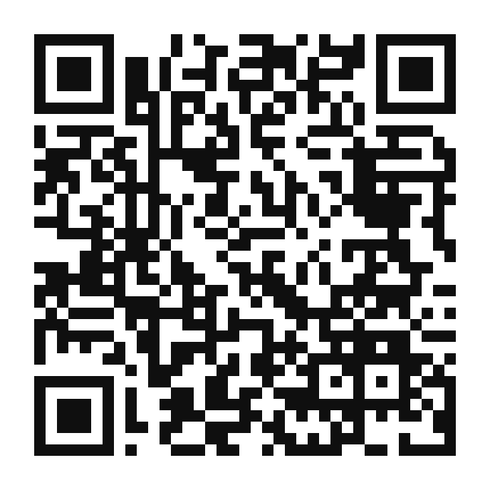
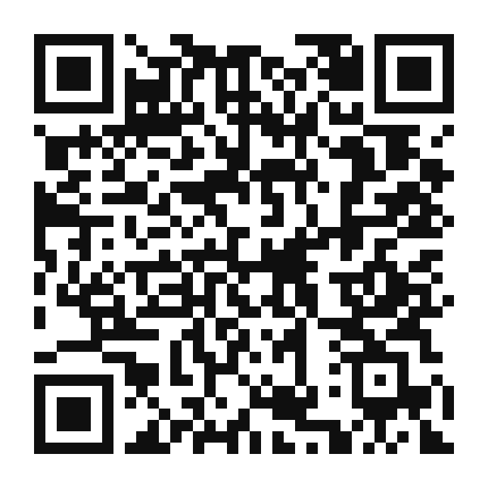
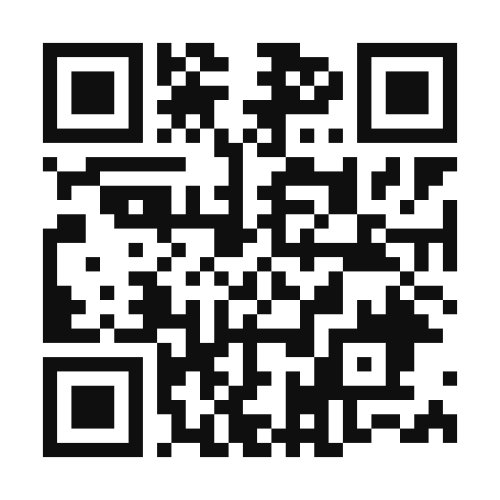
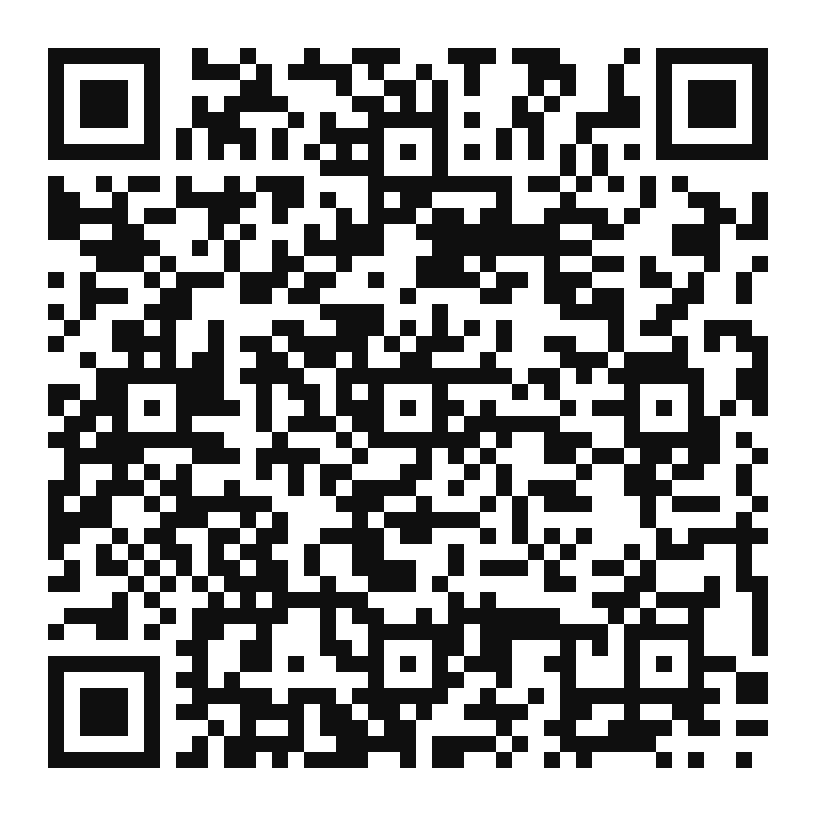

# 📱 Documentação dos QR Codes e Roteiro de Apresentação (Talita)

Este documento reúne o mapeamento completo dos **7 QR Codes** inseridos na cartilha **[Guia de Bolso: Cultura Digital com Direitos](./Guia_de_Bolso_Cultura_Digital_com_Direitos_QRCodes.pdf)**, as imagens geradas em alta resolução e o roteiro de fala para o seminário da disciplina de **Tópicos Especiais II**.

---

## 🔗 1. Mapeamento e Visualização dos 7 QR Codes

Todos os códigos foram gerados com nível de correção de erro **M (15%)**, exportados em **PNG** (pasta [`./qrcodes/`](./qrcodes)) e injetados em **formato vetorial + links clicáveis** diretamente nas páginas **1**, **4** e **7** do PDF da cartilha.

| # | Página | Identificação na Cartilha | Canal Oficial / Destino | QR Code |
| :-: | :-: | :--- | :--- | :-: |
| **1** | **Pág. 1** (Capa) | `ECA DIGITAL` | **Ministério da Justiça e Segurança Pública — ECA Digital** https://www.gov.br/mj/pt-br/assuntos/sua-protecao/sedigi/eca-digital/eca-digital-1 |  |
| **2** | **Pág. 4** (Esquerda) | `Guia Antifraude` *(Proteção contra Phishing)* | **UFMA — Guia de Proteção contra Phishing e Fraudes** https://portalpadrao.ufma.br/sti/seh/temas/protecao-contra-phishing-e-fraudes |  |
| **3** | **Pág. 4** (Direita) | `SaferNet Brasil` *(Prevenção ao Ciberbullying)* | **SaferNet Brasil — Portal Educativo e Prevenção** https://new.safernet.org.br/ |  |
| **4** | **Pág. 7** (Sup. Esq.) | `Disque 100 Online` | **Ouvidoria Nacional de Direitos Humanos (MDHC / Disque 100)** https://www.gov.br/mdh/pt-br/ondh |  |
| **5** | **Pág. 7** (Sup. Dir.) | `safernet.org.br` | **SaferNet Brasil — Canal Oficial de Denúncias e Helpline** https://new.safernet.org.br/denuncie |  |
| **6** | **Pág. 7** (Inf. Esq.) | `gov.br/anpd` | **ANPD — Autoridade Nacional de Proteção de Dados** https://www.gov.br/anpd/pt-br |  |
| **7** | **Pág. 7** (Inf. Dir.) | `Guia de Telas` | **Secom / Governo Federal — Guia de Uso de Telas por Crianças e Adolescentes** https://www.gov.br/secom/pt-br/assuntos/uso-de-telas-por-criancas-e-adolescentes/guia/capitulos/conhecendo-os-riscos |  |

---

## 🎤 2. Roteiro de Fala para o Seminário (Talita)

Durante a etapa de **Demonstração do Produto e dos QR Codes**, a apresentação pode ser dividida em **3 blocos objetivos (2 a 3 minutos)**:

### Bloco 1 — Por que utilizamos QR Codes no Guia de Bolso? (Papel Pedagógico)
> *"Pessoal, a minha função no projeto foi realizar a curadoria, geração e conferência dos QR Codes da cartilha. Mas por que os QR Codes têm um papel central nessa proposta? Porque o problema que identificamos é que materiais jurídicos e textos extensos acabam afastando as famílias. Para que o **Guia de Bolso** continuasse curto, visual e acessível (com apenas 8 páginas), os QR Codes funcionam como uma **ponte prática entre o guia impresso e as fontes oficiais de aprofundamento e denúncia**."*

### Bloco 2 — Como os 7 QR Codes estão distribuídos na Cartilha?
> *"Nós organizamos 7 QR Codes estratégicos ao longo de três páginas da cartilha:*
> - *Na **Página 1 (Capa)**, temos o QR Code que leva à página oficial do **ECA Digital no Ministério da Justiça**, permitindo que famílias e educadores consultem diretamente os detalhes da Lei nº 15.211/2025.*
> - *Na **Página 4 (Dicas Práticas de Segurança e Proteção)**, colocamos dois QR Codes voltados à prevenção: o primeiro leva ao **Guia Antifraude sobre Phishing (da UFMA)**, ensinando a reconhecer links falsos e golpes, e o segundo leva à **SaferNet Brasil**, com orientações de prevenção ao ciberbullying.*
> - *Na **Página 7 (Canais Oficiais de Apoio e Denúncia)**, reunimos 4 QR Codes de ação rápida: o **Disque 100 Online** (para violações de direitos humanos contra crianças e adolescentes), o **Canal de Denúncia e Helpline da SaferNet**, a página oficial da **ANPD** (Autoridade Nacional de Proteção de Dados, que fiscaliza as plataformas segundo o ECA Digital) e o **Guia de Uso Consciente de Telas da Secom/Governo Federal**."*

### Bloco 3 — Cuidados Técnicos, Acessibilidade e Manutenção
> *"Do ponto de vista técnico, desenvolvemos um script em Node.js que gera as imagens em alta resolução e também injeta os QR Codes **em formato vetorial e com links clicáveis diretamente no PDF**. Isso foi pensado porque a escola pode tanto entregar a cartilha impressa nas reuniões de pais — onde o responsável aponta a câmera do celular — quanto enviar o PDF nos grupos de WhatsApp da turma — onde basta tocar sobre o QR Code na tela para abrir o canal oficial. Por fim, como destacamos nas limitações do relatório, como os QR Codes apontam para páginas externas governamentais, recomenda-se que a escola confira periodicamente se os endereços oficiais sofreram atualização."*
